# Flow

User and application flows for **skmgr**.

## Command map

| Command | What the user wants | What the app does |
|---------|---------------------|-------------------|
| `init` | Start a project | Detect agents from existing dirs; write `skmgr.yml`; create `.agents/{skills,rules}` |
| `add <source>` | Add a dependency | Sync with the entry appended → write manifest and lock on success |
| `remove <name>` | Drop a dependency | Sync without the entry → unlink, delete canonical copy, scrub merged block |
| `install` | Install from manifest | Sync → write lock. `--frozen` pins to the lock; `--offline` forbids network |
| `update [name...]` | Refresh refs | Sync with the named entries unpinned, the rest held at their locked SHA |
| `sync` | Align disk with manifest | Same pipeline as install |
| `list` | See installed skills | Read manifest and lock; hash what is on disk; print a table or JSON |
| `verify` | Confirm nothing drifted | Hash each installed skill and compare to the lock; never touches the network |
| `outdated` | See what is available | Read each source's tags; report installed, newest in range, newest overall |
| `cache path\|info\|prune` | Inspect or shrink the cache | Report cached commit trees; delete them by age or total size |
| `clean` | Wipe installs / cache | Strip merged blocks, remove `.agents/`, prune broken links; `--global` and `--cache` extend the scope |
| `tree` | See the layout | Group resolved skills by scope, then by agent, and print the shape |
| `doctor` | Find out why something is broken | Check git, config, cache, store, symlink support, and install drift; exit `3` on any failure |
| `self-update` | Get the newest skmgr | Read the latest GitHub release, download the build for this platform, swap the binary atomically. Bootstrap installs use `scripts/install.sh` (Unix) or `scripts/install.ps1` (Windows). |
| `completion <shell>` | Tab completion | Emit a completion script for bash, zsh, fish, or powershell |

Every command that changes the project — `add`, `remove`, `install`, `update`,
`sync` — also takes `--dry-run`, which resolves normally and reports what would
change without writing anything.

## Happy path (new project)

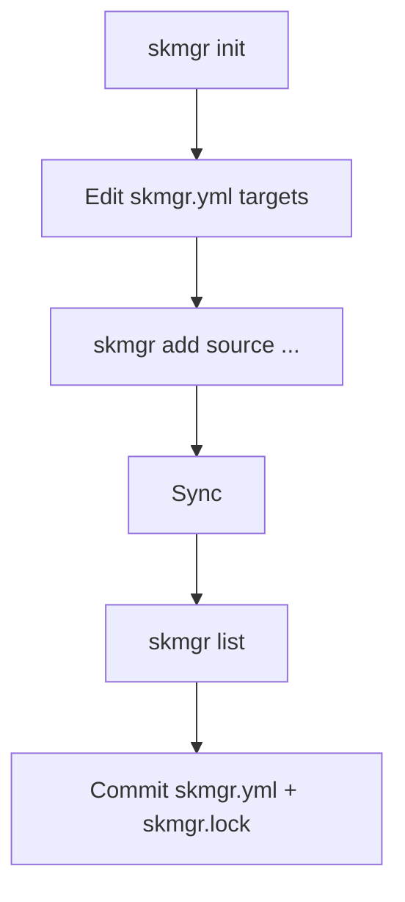

Typical CI path after that: `skmgr install --frozen`.

## Core Sync pipeline

Shared by `install`, `sync`, `update`, and post-`add` / `remove`.

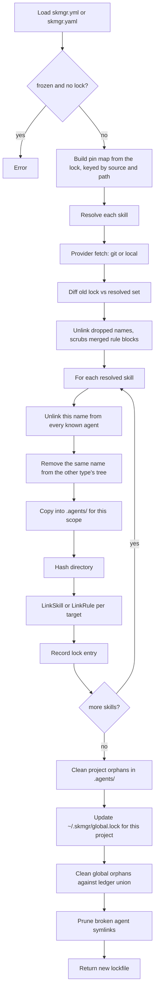

Two cleanup passes are deliberately different. Project orphans are decided from
this project's manifest alone. Global orphans are decided from the ledger union,
because `~/.agents/` is shared by every project on the machine.

Unlinking sweeps every known agent rather than the current target list, because
a skill whose `targets` shrank still has links under the agents it dropped. The
correct links are recreated in the same iteration, so the only visible effect is
that stale ones disappear. The same reasoning covers a changed `type`: the copy
under the other tree is removed before installing, since orphan cleanup matches
on name and would otherwise consider it valid.

## Global scope and the ledger

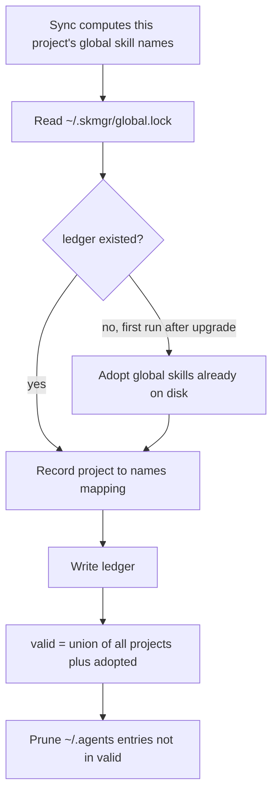

Adoption exists so that upgrading from a version without a ledger cannot delete
global skills that skmgr has no ownership record for.

## Resolve detail

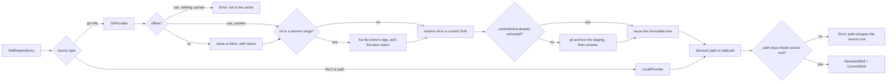

- Git: clone or fetch, resolve `ref` to a SHA, extract that commit once, discover
  `path` / wildcards. Clone and fetch run under a per-source lock; the extracted
  tree is immutable, so reads are lock-free and concurrent runs cannot collide.
- Network failures that look transient are retried three times with exponential
  backoff before the command gives up.
- Type auto-detect (wildcard): `SKILL.md` → skill, `AGENTS.md` → rule.
- Discovery expects skills under a parent named `skills`, rules under `rules`.
- A literal `path` is resolved and rejected if it escapes the source root; glob
  matches are re-filtered after expansion for the same reason.

### Choosing the checkout

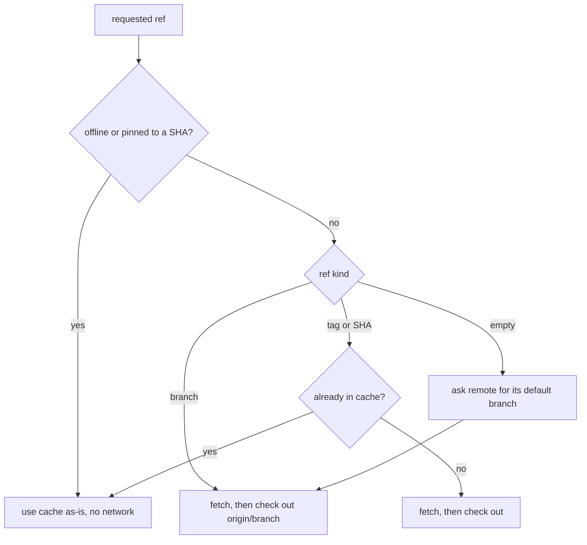

A branch is a moving target, so the cached clone must follow the remote —
checking out the local branch is what used to serve stale commits forever. A tag
or SHA is immutable, so once cached it is reused and the network is skipped.

## Version ranges

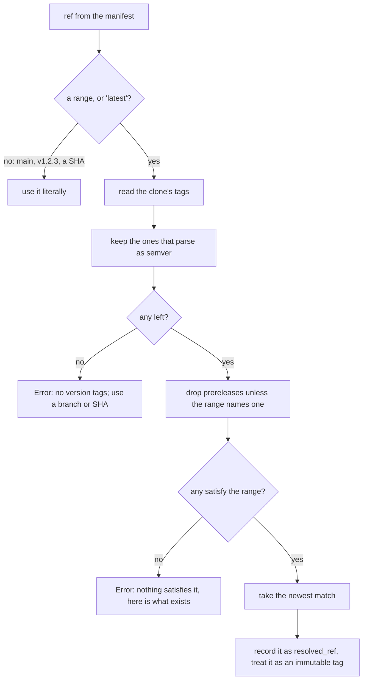

Detection is deliberately narrow: `ref` may also be a branch name, so only
`latest`, a leading operator, a version wildcard, or a compound constraint is
read as a range. A bare `v1.2.3` is an exact tag, and `release-2` is a branch.

Tags come from the cached clone, which is fetched with `--tags` on every run, so
resolution needs no extra network call and works under `--offline`.

`skmgr update` keeps a range: it re-resolves and lands on the newest tag inside
it. `--latest` ignores the range for that one run without rewriting the
manifest, so the next plain update returns to the declared bounds.

## Verify flow

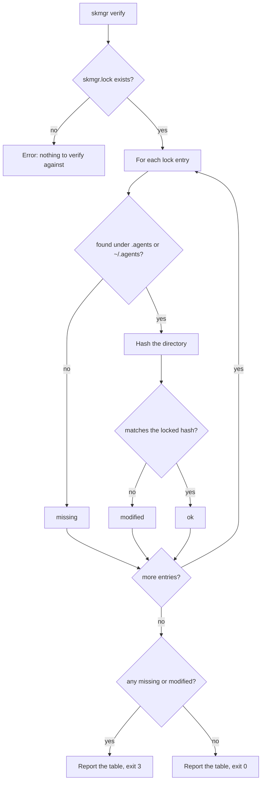

Verify never contacts a remote, so it is safe in an air-gapped job and cheap
enough to run as a pre-commit or CI guard. `list` reports the same three states
in its status column, computed the same way.

Exit `3` means drift specifically, as opposed to `1` for a failure to run at
all. That lets a pipeline fail a pull request because a skill was edited without
also failing when the network is down.

## Dry-run flow

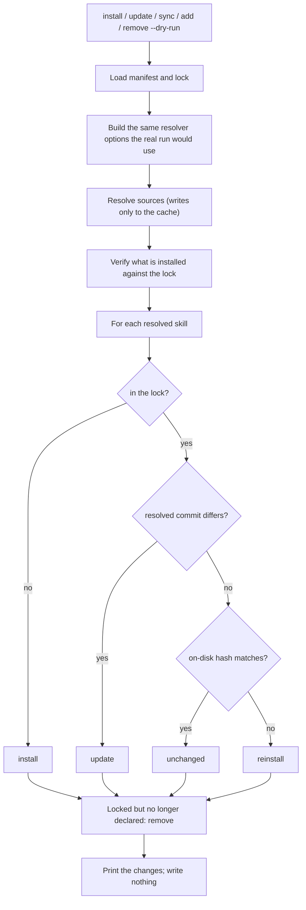

A dry run resolves for real, because there is no way to know whether a branch
has moved without asking. That touches the download cache and nothing else: no
lockfile, no manifest edit, no files installed or deleted. The resolver options
are built by the same code the real run uses, so the plan cannot be computed
under different rules than the run it predicts.

## Doctor flow

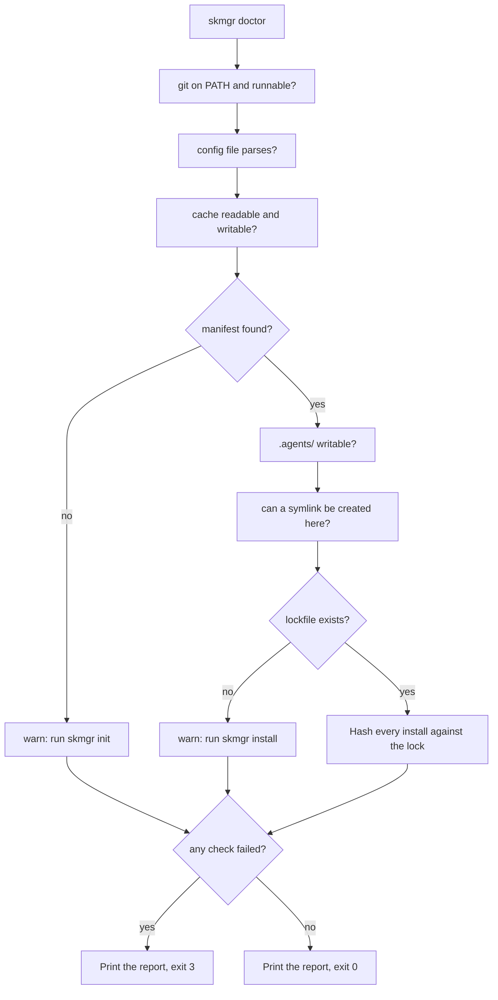

Checks never stop at the first failure: someone running doctor wants the whole
picture, not one problem at a time. A missing manifest or lockfile is a warning
rather than a failure, because a fresh project is incomplete, not broken. The
symlink check actually creates one, since that is the only way to find out
whether an unprivileged Windows session or an unusual filesystem will allow it.

## Tree flow

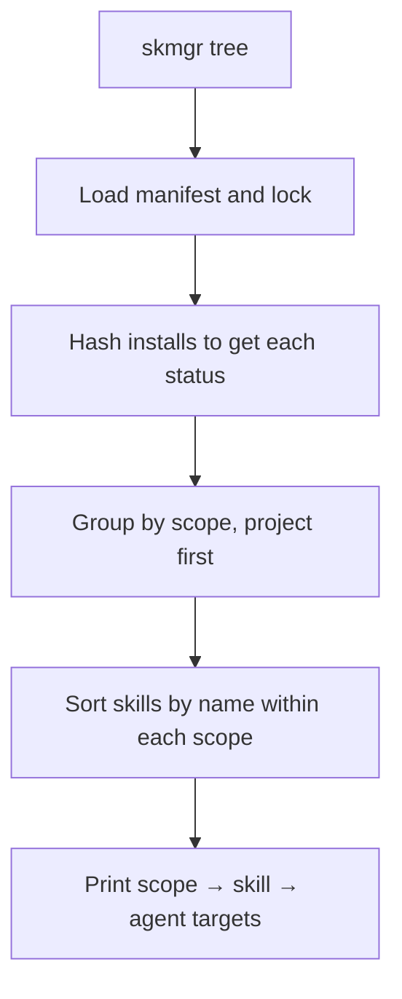

Where `list` is a flat table for scanning, `tree` shows the shape, which is the
quicker way to notice that a skill is missing from an agent you expected it in.

## Install integrity

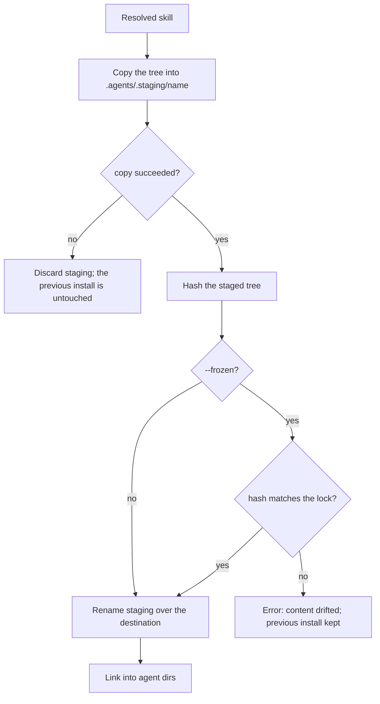

The hash is checked before the rename, not after. Detecting drift after the swap
would mean reporting a failure the tool had already committed to disk.

## Link detail

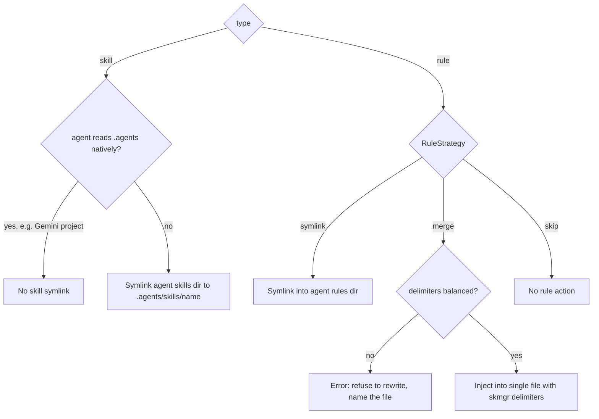

Scope picks the root for the agent directories too: project scope links into
`<project>/.cursor/`, global scope links into `~/.cursor/`.

Linker also maintains a managed block in `.gitignore` for generated agent paths.
Both the merge and the `.gitignore` block refuse to rewrite a file whose managed
delimiters are unbalanced, since doing so would drop everything after the
orphaned marker.

## Add flow

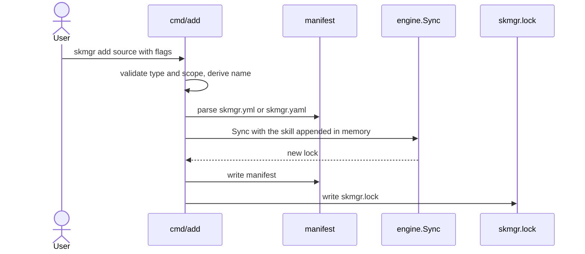

The manifest is written only after the install succeeds, so a failed add does
not leave a manifest claiming a skill that was never installed. `--name` is
optional: without it the name is derived from the path, or from the repository
name when there is no path.

## Remove flow

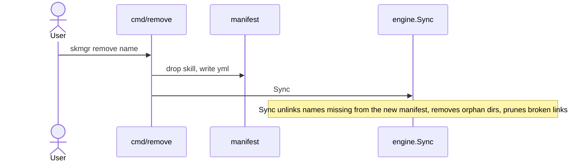

Because the dropped skill is gone from the manifest, Sync sweeps every known
agent for it. That is what removes a merged rule block, which leaves no symlink
for the broken-link pass to catch.

## Install / update / sync

All three run `engine.Sync`; what differs is which entries are allowed to move.

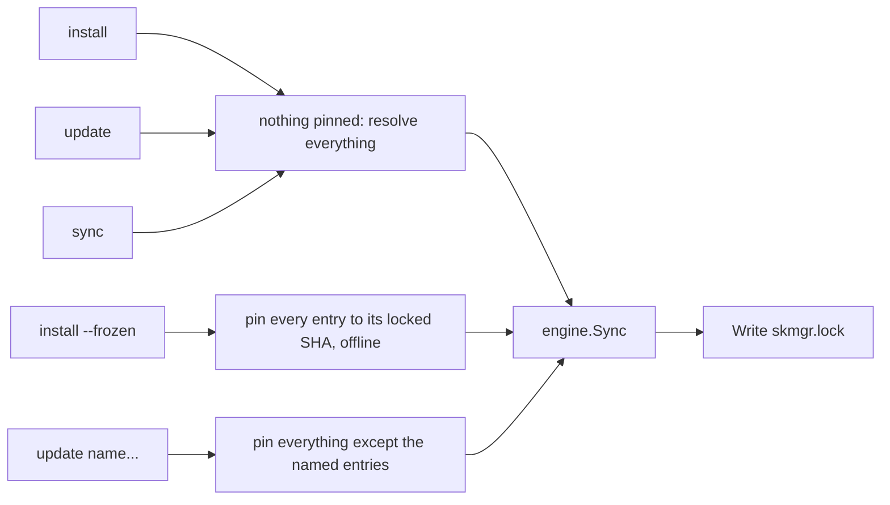

| Command | Resolves | Network | Notes |
|---------|----------|---------|-------|
| `install` | Everything | Yes | The default. Moving refs advance. |
| `install --frozen` | Nothing | No | Every entry pinned to its locked SHA. Fails if the lockfile is missing. |
| `update` | Everything | Yes | Same as install; exists to state the intent. Ranges stay inside their bounds. |
| `update <name>...` | Named only | Yes | Others held at their locked SHA. Unknown names are an error. |
| `update --latest` | Everything moving | Yes | Ranges are ignored in favor of the newest tag. The manifest is not rewritten. |
| `sync` | Everything | Yes | Re-align `.agents/` and agent dirs with what is on disk. |
| any, with `--offline` | Cached only | No | Anything not already cached fails. `SKMGR_OFFLINE=1` sets this for a whole job. |
| any, with `--dry-run` | Everything | Yes | Reports the plan and writes nothing — no lockfile, no manifest edit, no installs. |

Even a named update resolves the full set, because an entry missing from the
resolved set looks like an orphan and would be deleted. Pinning, not exclusion,
is what limits the blast radius. Pins are keyed on source and path rather than
name, so wildcard expansions — whose names are generated during resolution — can
be pinned too.

Entries without a recorded commit SHA, which is every local `file://` source,
cannot be pinned and are re-read from disk even under `--frozen`.

## Data flow (runtime dirs)

```
Remote git / local path
        │
        ▼
 ~/.skmgr/cache/git/<sha256(source)>/commits/<commit-sha>/
        │  copy via .agents/.staging, then rename
        ▼
 project scope: .agents/skills/<name>/   or   .agents/rules/<name>/
 global  scope: ~/.agents/skills/<name>/ or   ~/.agents/rules/<name>/
        │  symlink or merge (same root as the scope above)
        ▼
 <root>/.cursor/skills|rules
 <root>/.claude/skills + CLAUDE.md
 <root>/.gemini/...
 <root>/.github/skills + copilot-instructions.md

 where <root> is the project dir for project scope, ~ for global scope
```

Ownership of the global tree is tracked separately in `~/.skmgr/global.lock`.

## Clean flow

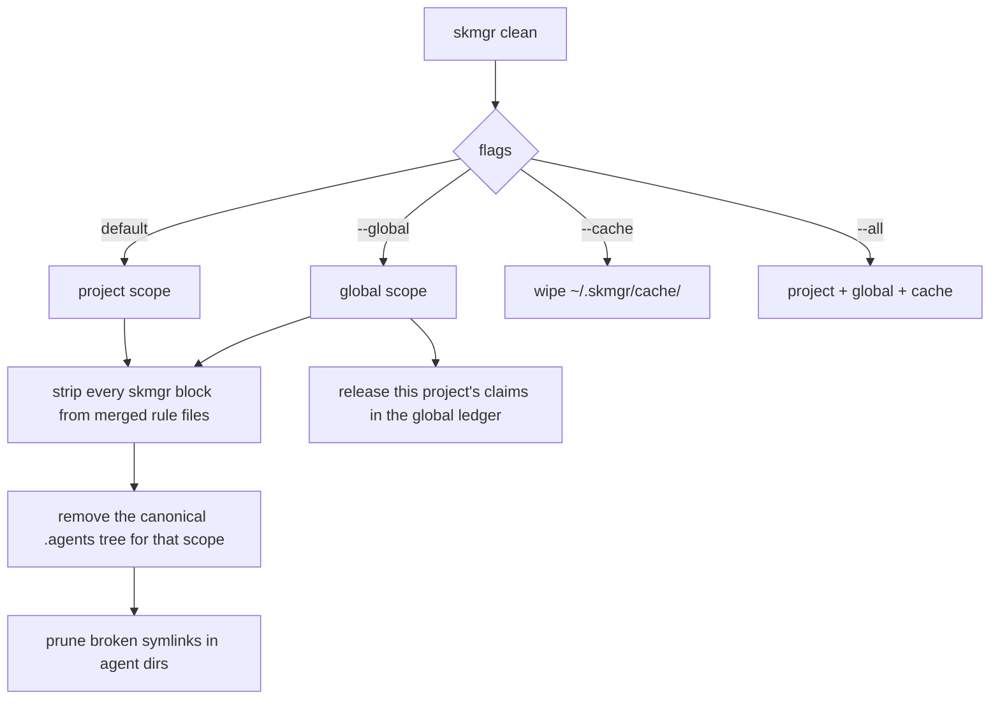

Stripping happens before the canonical tree is deleted: a merged block leaves no
symlink, so once the tree is gone there is nothing left to tell the linker which
blocks to remove. A project-scoped clean never touches the global tree.

## Actors

| Actor | Interaction |
|-------|-------------|
| Developer | Local CLI against project + home dirs |
| Team / VCS | Shares `skmgr.yml` + `skmgr.lock` |
| CI | Runs `skmgr install --frozen`, then `skmgr verify` |
| Agents | Read linked/merged files; not aware of skmgr |

## Recommended CI flow

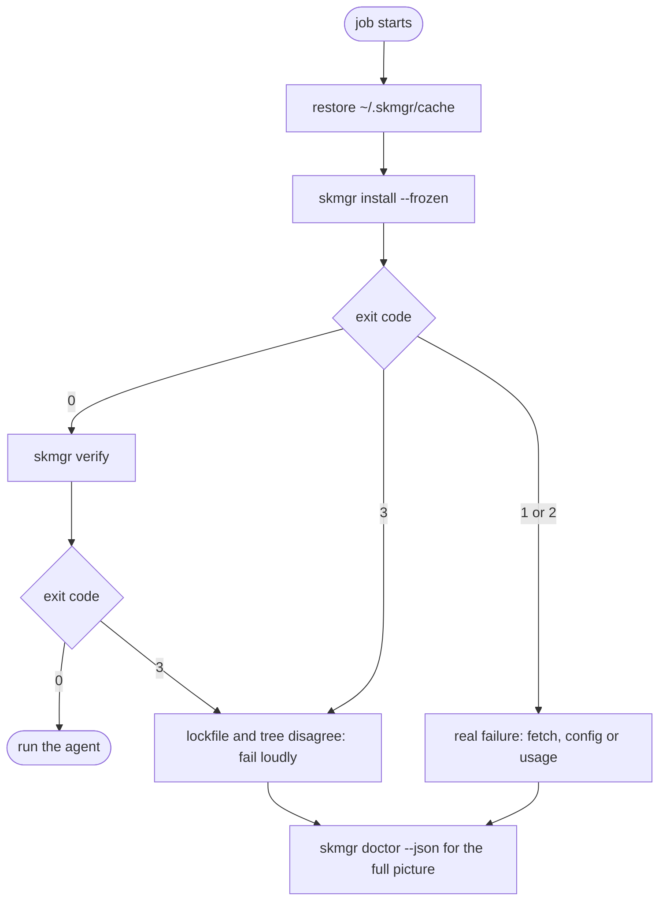

Branching on `3` separately from `1` is what makes the failure legible: drift
means the committed lockfile no longer describes the tree, which a developer
fixes by rerunning `install` and committing, while `1` means the run itself
could not complete. Treating both as "failed" sends people looking in the wrong
place.

<!-- last-phase: 5 -->
